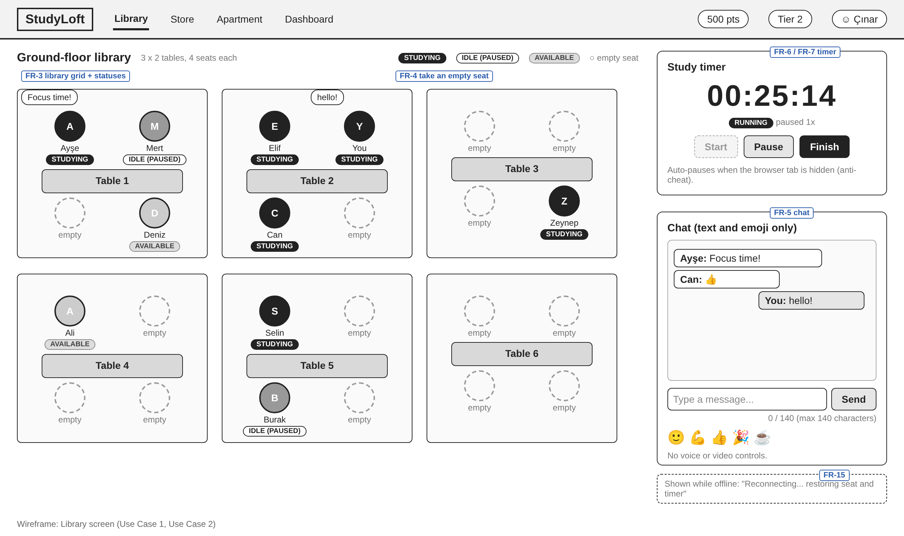
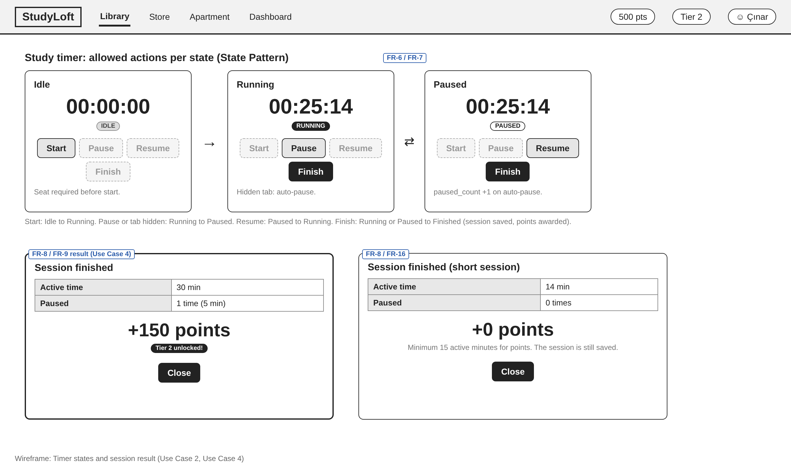
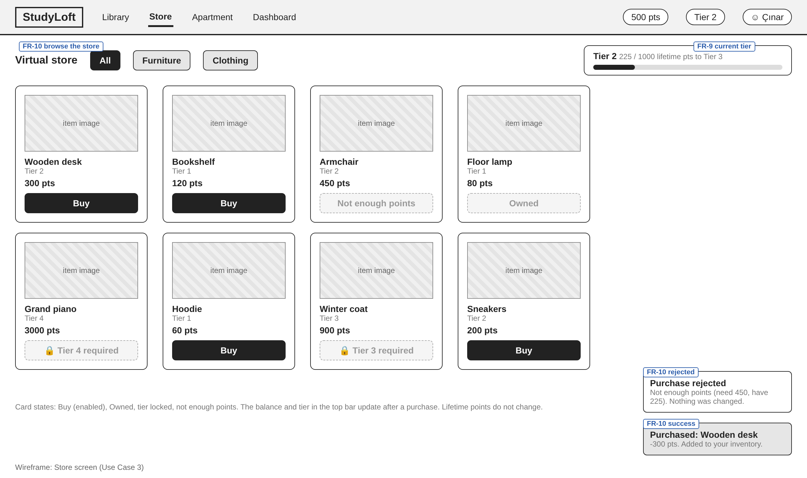
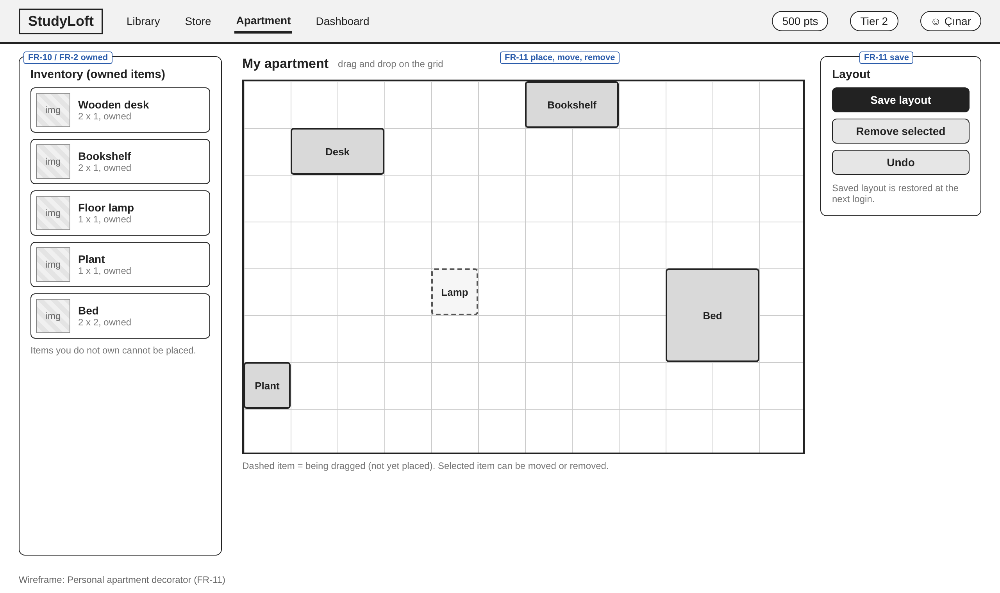
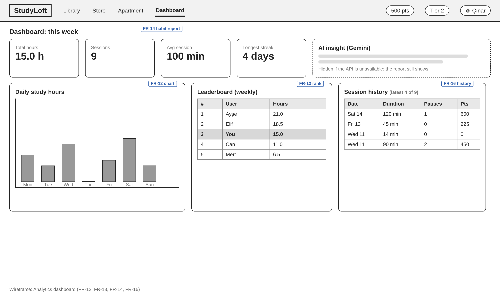
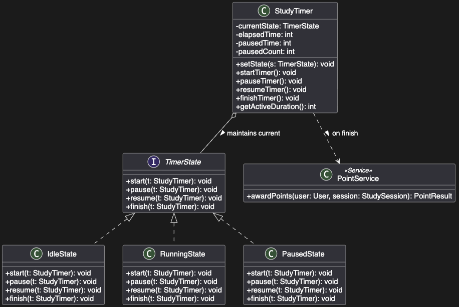
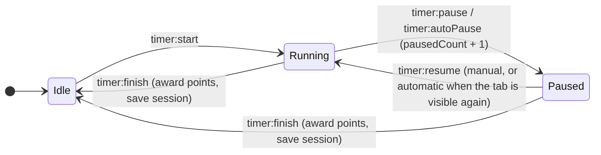
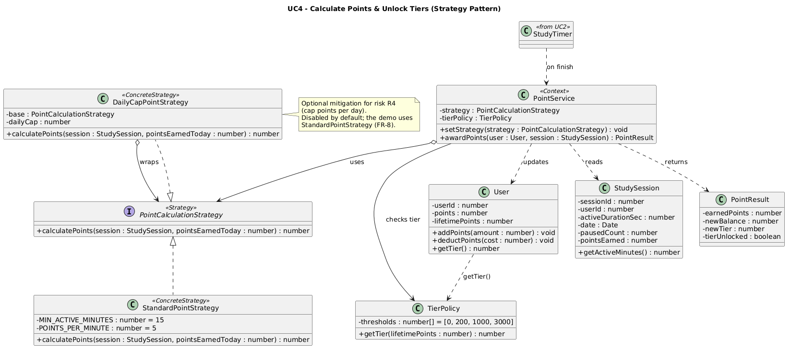
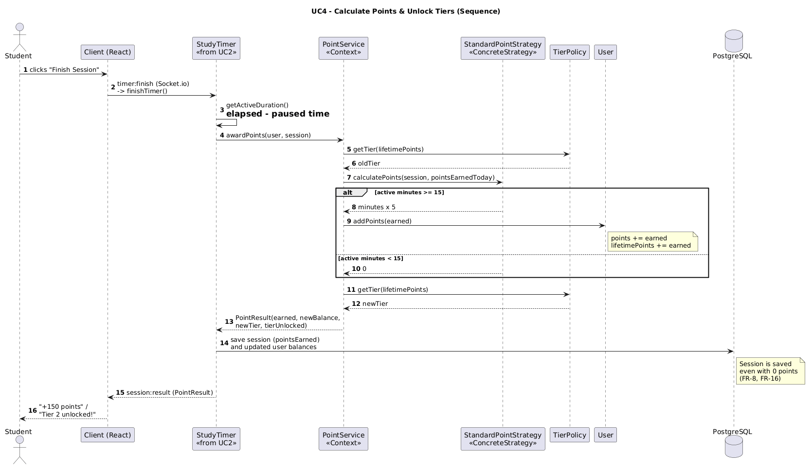
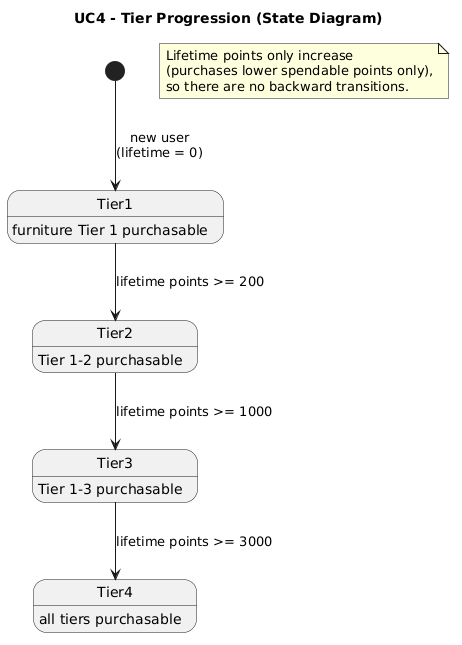

# Design Document

## Table of Contents
1. [Task Matrix](#task-matrix-design-document)
2. [Contributors](#contributors)
3. [1. System Overview](#1-system-overview)
4. [2. Implementation Details](#2-implementation-details)
5. [3. Use Case Support in Design](#3-use-case-support-in-design)
6. [4. Design Decisions](#4-design-decisions)

## Task Matrix (Design Document)

| Document Section | Responsible Member |
| :--- | :--- |
| **1. System Overview** (Description, Architecture, Tech Stack) | Nildeniz Efe |
| **2. Implementation Details** (Codebase Structure, Key Modules, UI) | Çınar Aktaş |
| **3.1 Use Case 1: Interact in Library** (Observer Pattern & UML) | Işıkalp Karakaş |
| **3.2 Use Case 2: Manage Study Timer** (State Pattern & UML) | Işıkalp Karakaş |
| **3.3 Use Case 3: Buy Items in Store** (Factory Pattern & UML) | Çınar Aktaş |
| **3.4 Use Case 4: Calculate Points & Unlock Tiers** (Strategy Pattern & UML) | Delfin Kütükçü |
| **4. Design Decisions** (Tech Comparisons & Justifications) | Nildeniz Efe |

## Contributors
* Işıkalp Karakaş
* Delfin Kütükçü
* Nildeniz Efe
* Nadide Zeynep Dedeoğlu
* Çınar Aktaş

---

## 1. System Overview

### Brief Project Description
StudyLoft is a multiplayer virtual apartment study platform designed to tackle student isolation, lack of motivation, and poor consistency during long study sessions. By combining the psychological "body-doubling" effect with engaging gamification, StudyLoft provides a ground-floor virtual library where users can study together using real-time avatars and integrated study timers. Communication is strictly limited to text and emojis to maintain a distraction-free, focused study environment (voice and video chats are intentionally excluded). 

Completed study sessions award points based on active study duration, which users redeem in a virtual store for tiered furniture and clothing items. These items are then used to decorate their own personal apartment floor. Additionally, a comprehensive analytics dashboard featuring weekly study charts, habit reports, leaderboards, and AI-powered insights via the Gemini API helps students monitor and improve their long-term productivity.

### System Architecture
StudyLoft adopts a robust **client-server architecture** optimized for low-latency, real-time multiplayer interactions:
*   **Client Tier:** A single-page application (SPA) built using React.js that renders the user interface, 2D grid environments, apartment decorator, and analytics dashboards.
*   **Real-Time / WebSocket Tier:** A dedicated Node.js server running **Socket.io** to manage low-latency, bidirectional broadcasting of avatar presence, seating states, chat messages, and automatic connection recovery with exponential backoff.
*   **Application & REST API Tier:** Handles user authentication, session history logging, store purchases, and communicates securely with the **Google Gemini API** for weekly habit analysis report generation.
*   **Data Tier:** A relational database (**PostgreSQL**) storing structured data entities including user profiles, active study sessions, item inventories, and floor layouts.

### Technology Stack
*   **Frontend:** React.js, HTML5 Canvas / 2D Grid Renderer, CSS modules, Chart.js / Recharts (for analytics dashboards).
*   **Backend:** Node.js, Express.js, Socket.io (for real-time multiplayer state synchronization).
*   **Database:** PostgreSQL (Relational Database Management System).
*   **AI Integration:** Google Gemini API (for generating personalized weekly productivity and habit insights).
*   **Version Control & CI:** Git, GitHub (branching strategy, pull request reviews, automated tests).
  
## 2. Implementation Details

### 2.1 Codebase Structure

The repository is organized by area, so each folder shows who maintains what. The server is written in **TypeScript** on Node.js and organized **by feature**: each feature (points, store, library, timer) has its own folder with its classes. The client and the server are separate applications that talk through a REST API (accounts, store, history, dashboard) and a WebSocket connection (library presence, chat, timer).

```text
BIL481-2026-Project/
├── server/                          # Node.js + TypeScript backend
│   ├── package.json, tsconfig.json, jest.config.js
│   ├── src/
│   │   ├── models/                  # User.ts, StudySession.ts                  [implemented]
│   │   ├── points/                  # Strategy Pattern (UC4)                    [implemented]
│   │   │   ├── PointCalculationStrategy.ts   # strategy interface
│   │   │   ├── StandardPointStrategy.ts      # FR-8 rule (active strategy)
│   │   │   ├── DailyCapPointStrategy.ts      # optional daily cap (risk R4)
│   │   │   ├── PointService.ts               # context
│   │   │   ├── TierPolicy.ts                 # lifetime points -> tier (FR-9)
│   │   │   └── PointResult.ts
│   │   ├── store/                   # Factory Pattern (UC3): StoreItem, ItemFactory, StoreService   [planned]
│   │   ├── library/                 # Observer Pattern (UC1): LibraryRoom, seats, chat              [planned]
│   │   ├── timer/                   # State Pattern (UC2): StudyTimer, Idle/Running/PausedState     [planned]
│   │   ├── routes/ and sockets/     # REST endpoints and Socket.io handlers                         [planned]
│   │   └── db/                      # PostgreSQL schema and repositories                            [planned]
│   └── tests/
│       └── points/points.test.ts    # 18 Jest unit tests for FR-8 and FR-9      [implemented]
├── client/                          # React web application                     [planned]
│   └── src/                         # pages (Library, Store, Apartment, Dashboard), components, hooks, services
└── docs/                            # Project documents, UML diagrams, wireframes (docs/images/)
```

The server follows a **layered architecture**: routes and socket handlers (presentation) call services (business logic), and services call repositories (data access) that talk to PostgreSQL. The business classes of the four use cases do not depend on the database or on Socket.io, so they can be unit tested on their own.

*Current status:* the points and tier module (Use Case 4) with its models and tests is already implemented in `server/`. The store, library, and timer modules, the REST and WebSocket layer, the database, and the client follow the interfaces defined in this document.

### 2.2 Key Implementations

| Module | Responsibility | Related requirements | Pattern | Status |
| :--- | :--- | :--- | :--- | :--- |
| Points and tiers | Converts a finished session into points and derives the tier from lifetime points. | FR-8, FR-9 | Strategy (UC4) | Implemented, tested |
| Models | `User` (points, lifetime points, tier) and `StudySession` (active duration, paused count, points earned). | FR-8, FR-9, FR-16 | - | Implemented |
| Study timer | Controls the lifecycle Idle, Running, Paused. The server keeps the authoritative timer state; the client sends the controls and an automatic pause when the browser tab is hidden. | FR-6, FR-7, FR-15 | State (UC2) | Planned |
| Library and presence | Keeps the list of users and seats in the shared library and pushes every change (join, leave, sit, chat, status) to all connected clients. | FR-3, FR-4, FR-5 | Observer (UC1) | Planned |
| Store and inventory | Lists items, checks tier and points, deducts the cost, and adds the item to the inventory in one database transaction. | FR-10, FR-9 | Factory (UC3) | Planned |
| Session history, apartment layout, dashboard | Store finished sessions, save the apartment layout, produce weekly chart, leaderboard, and habit report with an optional Gemini insight. | FR-16, FR-11, FR-12, FR-13, FR-14 | - | Planned |
| Authentication | Registration, login, logout, salted password hashes, authenticated WebSocket connections. | FR-1, NFR-3 | - | Planned |

**Core business logic**

- **Active study time.** The server counts only the time spent in the Running state: active duration = elapsed time minus paused time. Every automatic pause increases `pausedCount` by 1. The client never sends a duration or a point value (anti-cheat, risk R4).
- **Points (FR-8).** `StandardPointStrategy` rounds the active duration down to whole minutes. A session of at least 15 minutes gives `5 × minutes` points; a shorter session gives 0 points, but the session record is still saved (14 min 59 s counts as 14 minutes).
- **Tiers (FR-9).** `TierPolicy` derives the tier from lifetime points with the thresholds `[0, 200, 1000, 3000]` (Tier 1 to Tier 4). The tier is calculated, not stored, so it cannot become inconsistent. Spending points lowers only `points`, never `lifetimePoints`, so the tier never drops after a purchase.
- **Award flow.** `PointService.awardPoints()` reads the old tier, asks the active strategy for the earned points, adds them to the user, stores them in the session, reads the new tier, and returns a `PointResult` with the new balance and `tierUnlocked`.
- **Purchase (FR-10).** A purchase is accepted only if the item exists, is not owned yet, its tier is unlocked, and `points >= cost`. Otherwise nothing changes and an error message is returned.
- **Reconnection (FR-15).** If the WebSocket drops, the client reconnects with exponential backoff and the server restores the user's seat, status, and timer state.

### 2.3 Component Interfaces

**Class and method signatures.** The points module and the models are taken from the implemented code in `server/src/`; the other modules follow the UML diagrams in Section 3.

```ts
// ---- Implemented: server/src/points and server/src/models (UC4) ----
interface PointCalculationStrategy {
  calculatePoints(session: StudySession, pointsEarnedToday: number): number;
}
class StandardPointStrategy implements PointCalculationStrategy { /* FR-8 rule */ }
class DailyCapPointStrategy implements PointCalculationStrategy {
  constructor(base: PointCalculationStrategy, dailyCap: number);
}
class PointService {
  setStrategy(strategy: PointCalculationStrategy): void;
  awardPoints(user: User, session: StudySession, pointsEarnedToday?: number): PointResult;
}
class TierPolicy { getTier(lifetimePoints: number): number; }
interface PointResult { earnedPoints: number; newBalance: number; newTier: number; tierUnlocked: boolean; }

class User {
  addPoints(amount: number): void;      // increases points and lifetimePoints
  deductPoints(cost: number): void;     // decreases points only; throws if not enough points
  getPoints(): number;  getLifetimePoints(): number;  getTier(): number;
}
class StudySession {                    // userId, sessionId, activeDurationSec, date, pausedCount, pointsEarned
  getActiveMinutes(): number;           // whole minutes, rounded down
}

// ---- Planned: follows the UML diagrams in Section 3 ----
// UC3 - Factory
interface StoreItem { getId(): number; getName(): string; getCost(): number; getTier(): number; }
class ItemFactory   { createItem(type: string, data: ItemData): StoreItem; }
class StoreService  {
  listItems(): StoreItem[];
  buyItem(userId: number, itemId: number): PurchaseResult;
}
// implementations: FurnitureItem, ClothingItem

// UC2 - State
interface TimerState { start(t: StudyTimer): void; pause(t: StudyTimer): void; resume(t: StudyTimer): void; finish(t: StudyTimer): void; }
class StudyTimer {
  setState(s: TimerState): void;  startTimer(): void;  pauseTimer(): void;
  resumeTimer(): void;  finishTimer(): void;  getActiveDuration(): number;
}
// implementations: IdleState, RunningState, PausedState

// UC1 - Observer
interface RoomSubject  { attach(obs: RoomObserver): void; detach(obs: RoomObserver): void; notifyObservers(): void; }
interface RoomObserver { update(roomState: object): void; }
class LibraryRoom implements RoomSubject {
  joinRoom(u: User): void;  leaveRoom(u: User): void;  receiveMessage(m: Message): void;
}
```

### 2.4 Visual Interfaces

The wireframes below are low-fidelity drafts of the five main screens. They show the layout and the controls of each screen; colors, final images, and styling will be defined during the frontend implementation. Small blue tags in the images show the functional requirement that each area supports. All screens use the same top bar with the navigation (Library, Store, Apartment, Dashboard) and the user's current points and tier.

**Library screen (Use Case 1 and Use Case 2: FR-3, FR-4, FR-5, FR-6, FR-7, FR-15)**
The library is shown as a grid of six tables with four seats each. Empty seats are dashed circles; occupied seats show the avatar, the user name, and the status (STUDYING, IDLE (PAUSED), AVAILABLE). Chat bubbles appear above the sender's avatar. The right column contains the study timer and the chat panel (text up to 140 characters and emoji reactions, no voice or video). A banner informs the user while the connection is being restored.



**Study timer states and session result (Use Case 2 and Use Case 4: FR-6, FR-7, FR-8, FR-9, FR-16)**
Each timer state enables only the legal actions (State Pattern): Idle allows only Start, Running allows Pause and Finish, Paused allows Resume and Finish. When a session is finished, a result dialog shows the active time, the number of pauses, the earned points, and a message if a new tier was unlocked. A session shorter than 15 active minutes shows 0 points, and the session is still saved.



**Store screen (Use Case 3: FR-9, FR-10)**
The store lists furniture and clothing items with name, tier, and cost, and can be filtered by category. Each item card has one of four states: Buy (enabled), Owned, locked by tier, or not enough points. A progress bar shows the current tier and the lifetime points needed for the next tier. After a purchase, a message confirms the result (success or rejection), and the points in the top bar are updated.



**Apartment decorator (FR-11, FR-2)**
The left panel lists the items the user owns. Items are dragged onto the apartment grid, moved, or removed; items the user does not own cannot be placed. The *Save layout* button stores the layout so that it is restored at the next login.



**Dashboard (FR-12, FR-13, FR-14, FR-16)**
The dashboard shows the weekly habit report (total hours, sessions, average session length, longest streak) with an optional AI insight, a bar chart of the daily study hours, the weekly leaderboard with the current user highlighted, and the session history. If the Gemini API is unavailable, the insight box is hidden and the rest of the page is shown normally.



**REST API endpoints** (all except register and login require an authenticated session)

| Method | Endpoint | Description | Requirement |
| :--- | :--- | :--- | :--- |
| POST | `/api/auth/register` | Create an account (unique username and e-mail) | FR-1 |
| POST | `/api/auth/login` | Log in, start a session | FR-1 |
| POST | `/api/auth/logout` | End the session | FR-1 |
| GET | `/api/store/items` | List store items (name, cost, tier) | FR-10 |
| POST | `/api/store/buy` | Buy an item. Body: `{ itemId }`. Returns new balance and inventory, or an error | FR-10 |
| GET | `/api/inventory` | List owned items | FR-10 |
| PUT | `/api/avatar/outfit` | Equip an owned clothing item | FR-2 |
| GET / PUT | `/api/apartment/layout` | Load / save the apartment layout | FR-11 |
| GET | `/api/sessions` | Session history of the user | FR-16 |
| GET | `/api/dashboard/weekly` | Daily study hours of the current week | FR-12 |
| GET | `/api/leaderboard` | Weekly ranking by study time | FR-13 |
| GET | `/api/report/weekly` | Habit report and optional insight | FR-14 |

**WebSocket events** (Socket.io, authenticated connection). Finished sessions are saved by the server when it receives `timer:finish`, so there is no REST endpoint for saving a session.

| Direction | Event | Payload / meaning | Requirement |
| :--- | :--- | :--- | :--- |
| Client to server | `library:join`, `library:leave` | Enter or leave the library | FR-3 |
| Client to server | `seat:take` | `{ seatId }`; rejected if occupied | FR-4 |
| Client to server | `chat:message`, `chat:emoji` | Text (max 140 characters) or emoji reaction | FR-5 |
| Client to server | `timer:start`, `timer:pause`, `timer:resume` | Timer controls | FR-6 |
| Client to server | `timer:finish` | Finishes the session; the server computes the duration, awards points (`PointService.awardPoints`), and saves the session | FR-6, FR-8, FR-16 |
| Client to server | `timer:autoPause` | Sent when the tab is hidden; increases `pausedCount` | FR-7 |
| Server to client | `room:state` | Full room state (users, seats, statuses), pushed to every observer | FR-3 |
| Server to client | `chat:new` | New chat bubble to show | FR-5 |
| Server to client | `timer:state` | Current timer state and elapsed time (also sent after reconnect) | FR-15 |
| Server to client | `session:result` | `PointResult`: earned points, new balance, new tier, `tierUnlocked` | FR-8, FR-9 |


## 3. Use Case Support in Design

### 3.1 Use Case 1: Interact in Library

**Requirement Mapping:** 
This use case directly supports **FR-3** (library grid, seat occupancy, and avatar statuses), **FR-4** (taking an empty seat; occupied seats cannot be selected), and **FR-5** (chat functionality and emoji usage) from our Requirements Document.
  
**UML Class Diagram:**


**Design Pattern & Justification: Observer Pattern**
  
We selected the Observer Pattern as the core architectural solution to handle real-time interactions within the virtual library. Based on our requirements, whenever a user performs a specific action (e.g., joins a desk, leaves the room, or sends a chat message), the screens of all other active users in that same room must be updated instantly without requiring manual page refreshes.

In this design, `LibraryRoom` acts as the Concrete Subject. It maintains a dynamic list of connected `UserClient` objects, which act as the Observers. Instead of forcing each client to repeatedly request (poll) the server for new data—which would consume excessive bandwidth and cause lag—the `LibraryRoom` automatically pushes the updated `roomState` to all attached observers via the `notifyObservers()` method exactly when a change occurs. This creates a highly scalable, decoupled architecture that perfectly complements a WebSocket-based backend infrastructure for real-time gamified study environments.

**Interaction Flow (data flow and state changes):**
1. The user opens the library. The client sends `library:join` over the authenticated Socket.io connection. `LibraryRoom.joinRoom(user)` adds the user to `activeUsers` and attaches the client as an observer.
2. `LibraryRoom` calls `notifyObservers()`, and the server pushes `room:state` (users, seats, statuses) to every connected client. Each `UserClient.update(roomState)` re-renders the grid (FR-3).
3. **Taking a seat (FR-4):** the client sends `seat:take` with `{ seatId }`.
   - **Seat empty:** the seat is marked occupied by the user, the avatar is shown on the seat with the status AVAILABLE, and the new `room:state` is pushed to all observers.
   - **Seat occupied:** the request is rejected and the room state does not change.
4. **Chat (FR-5):** the client sends `chat:message` (text) or `chat:emoji`. `LibraryRoom.receiveMessage(m)` handles it.
   - **Text of at most 140 characters, or an emoji:** the server pushes `chat:new` to all observers, and each client shows a chat bubble above the sender's avatar.
   - **Text longer than 140 characters:** the message is rejected and nothing is broadcast.
5. The user leaves the library. The client sends `library:leave`; `LibraryRoom.leaveRoom(user)` removes the user and detaches the observer. The user's seat becomes empty, and the updated `room:state` is pushed to the remaining clients.

**State changes:** a seat changes between *empty* and *occupied*; the room's user list changes on join and leave. The status of a seated avatar follows the study timer (Use Case 2): AVAILABLE while the timer is idle, STUDYING while it is running, and IDLE (PAUSED) while it is paused. Every change is followed by one `room:state` push, so all clients show the same room without polling.

### 3.2 Use Case 2: Manage Study Timer

**Requirement Mapping:** 
This use case directly supports **FR-6** (Timer state controls: start, pause, resume, finish, and active time calculation) and **FR-7** (Automatic pause when tab is hidden and paused count tracking) from our Requirements Document.

**UML Class Diagram:**



**Design Pattern & Justification: State Pattern**
We selected the **State Pattern** to manage the complex lifecycle and transition logic of the study timer. Initially, we considered applying the Strategy Pattern for this component. However, through architectural trade-off analysis, we concluded that while the Strategy Pattern is ideal for interchanging algorithms, our timer is fundamentally governed by strict behavioral boundaries and statuses (States: *Idle*, *Running*, *Paused*). For instance, an already running timer cannot be started again, and a paused timer cannot be paused twice.

By implementing the State Pattern, we avoid fragile and monolithic if-else condition blocks. Instead, we encapsulate state-specific behaviors into individual classes (`IdleState`, `RunningState`, `PausedState`) that all implement the `TimerState` interface. The `StudyTimer` acts as the **Context**, delegating behavior to its `currentState` object. This architecture strictly enforces legal state transitions and demonstrates a precise application of structural design beyond basic algorithmic swaps. Crucially, when the timer transitions to a finished state (e.g., via a `finishTimer()` method), the session data is logged, active duration is computed (`getActiveDuration()`), and `PointService.awardPoints(user, session)` is invoked for every finished session; the 15-minute threshold of **FR-8** is checked inside the point strategy (Use Case 4), so shorter sessions are saved with 0 points.

**Timer Flow (data flow and state changes):**
1. The seated user presses *Start*. The client sends `timer:start`; the server calls `StudyTimer.startTimer()` and the state changes from `IdleState` to `RunningState`. The avatar status changes from AVAILABLE to STUDYING.
2. **Manual pause (FR-6):** the client sends `timer:pause`; the state changes to `PausedState`. `timer:resume` changes it back to `RunningState`.
3. **Automatic pause (FR-7):** when the browser tab is hidden or minimized, the client sends `timer:autoPause`. The state changes to `PausedState`, `pausedCount` increases by 1, and the avatar status shown to other users changes to IDLE (PAUSED). When the tab becomes visible again, the client sends `timer:resume` and the timer continues without a user action. Only automatic pauses resume on their own; a timer that the user paused manually stays paused until the user presses *Resume*.
4. After every change the server sends `timer:state` (current state and elapsed time) to the client. The same event is sent after a reconnect, so the timer is restored (FR-15).
5. **Finish:** the user can finish from the running or the paused state. The client sends `timer:finish`. The server calls `StudyTimer.finishTimer()`, computes the active duration with `getActiveDuration()` (elapsed time minus paused time), saves the session, and calls `PointService.awardPoints(user, session)` (Use Case 4). The result is returned with `session:result`.
6. After the session is finished, the server releases the user's seat and pushes the updated `room:state` to all clients (Use Case 1).

The server keeps the authoritative timer state; the client only sends control events and never a duration (NFR-2, risk R4). Calls that are not legal in the current state (for example `start` while running, or `pause` while paused) are handled by the state object and do not change the timer.

**Timer State Diagram:**




### 3.3 Use Case 3: Buy Items in Virtual Store

**Requirement Mapping:**
This use case directly supports **FR-10** (browse the store and buy an item whose tier is unlocked and whose cost does not exceed the user's points). It depends on **FR-9** (furniture tiers unlocked by lifetime points) for the tier check, and its result feeds **FR-2** (equipping owned clothing) and **FR-11** (placing owned furniture in the apartment).

**UML Class Diagram:**


**Design Pattern & Justification: Factory Pattern**
The virtual store sells two kinds of products, furniture and clothing. They share a name, a cost, and a tier, but they differ in their own data: furniture has a size on the apartment grid, and clothing has an avatar slot. If the store code created these objects directly with `new FurnitureItem(...)` and `new ClothingItem(...)`, every new product type would force changes in the purchase logic.

We therefore selected the **Factory Pattern**. All products implement the common `StoreItem` interface (`getId()`, `getName()`, `getCost()`, `getTier()`). The `ItemFactory` class has one method, `createItem(type, data)`, which reads the item type from the database record and returns the matching `FurnitureItem` or `ClothingItem`. `StoreService` works only with the `StoreItem` interface and never needs to know the concrete class. A new product type (for example wallpaper) can be added by creating one new class and one new branch in the factory, without touching `StoreService`. This follows the Open/Closed Principle. We considered the Strategy Pattern, but the problem here is *which object to create*, not *which algorithm to run*, so Factory is the better fit.

**Purchase Flow (data flow and state changes):**
1. The user opens the store. `StoreService.listItems()` loads item records, and `ItemFactory` turns each record into a `StoreItem` (name, cost, tier).
2. The user selects an item and presses *Buy*. The client sends `POST /api/store/buy` with `{ itemId }`. The user is identified by the authenticated session.
3. `StoreService.buyItem(userId, itemId)` checks three conditions in `canPurchase()`:
   - the item exists and is not already owned (`Inventory.owns()`),
   - the item tier is not higher than the user's tier (`User.getTier()`, based on lifetime points, FR-9),
   - the user has enough points (`points >= cost`).
4. **Success:** `User.deductPoints(cost)` lowers the balance, `Inventory.add(item)` stores the item, and the server returns the new balance and inventory.
5. **Failure:** the server returns an error message (tier locked or not enough points). Points and inventory do not change.

The purchase runs as a single database transaction, so the point deduction and the inventory update happen together or not at all. The user's lifetime points do not change when buying, so the tier never drops after a purchase.

**Example (from FR-10 verification):** A user with 500 points buys a 300-point Tier-2 desk and has 200 points left. With 100 points, the same purchase is rejected and nothing changes.

### 3.4 Use Case 4: Calculate Points & Unlock Tiers

**Requirement Mapping:**
This use case directly supports **FR-8** (award 5 points per active minute for finished sessions of at least 15 minutes and update the user's points and lifetime points) and **FR-9** (unlock furniture tiers by lifetime points: Tier 1 = 0, Tier 2 = 200, Tier 3 = 1000, Tier 4 = 3000). It takes its input from **FR-6** and **FR-7** (the active duration excludes manual and automatic pauses) and stores its result in the session record of **FR-16**, which is saved even when no points are earned. The earned points are spent in the virtual store (**FR-10**, Use Case 3). The calculation runs on the server, which keeps the authoritative timer state (**NFR-2**), and the points and tier logic is covered by automated unit tests (**NFR-8**).

**Use Case Description:**

| Field | Description |
| :--- | :--- |
| Primary actor | System (StudyLoft) |
| Trigger | The user finishes a study session (Use Case 2, Manage Study Timer) |
| Preconditions | The user is logged in; the session is finished and its active duration has been computed by the server |
| Main flow | 1. The server computes the active duration (elapsed time minus paused time). 2. `PointService` passes the session to the active strategy. 3. The strategy returns the earned points (5 × active minutes if at least 15 minutes). 4. Points and lifetime points are increased. 5. `TierPolicy` recomputes the tier; if a new tier is reached, it is unlocked. 6. The session is saved and the user sees the earned points and the current tier. |
| Alternative flow | 3a. Active duration is below 15 minutes: 0 points are earned, balances and tier do not change, and the session record is still saved. |
| Postconditions | The session is stored with its earned points; the user's balances and tier are consistent |

**UML Class Diagram:**



**Design Pattern & Justification: Strategy Pattern**

The central question of this use case is *which rule turns a finished session into points*. Today the rule is FR-8, but it is the part of the system most likely to change: our risk analysis (R4, Project Definition Document) already lists a daily point cap as a possible anti-cheat measure, and thresholds may be tuned after user testing. If all rules were written as `if-else` branches inside one method, every change would modify tested business logic.

We therefore selected the **Strategy Pattern**. `PointCalculationStrategy` is the common interface with one method, `calculatePoints(session, pointsEarnedToday)`. `StandardPointStrategy` implements the FR-8 rule and is the active strategy used in the demo. `DailyCapPointStrategy` wraps another strategy and limits the total points per day; it is prepared as a ready mitigation for risk R4 but is **disabled by default**, so the FR-8 verification (30 minutes → 150 points) is unchanged. `PointService` is the **Context**: it calls only the interface and never knows which concrete rule is active. A strategy can be swapped with `setStrategy()`, and a new rule can be added as one new class without touching `PointService`, following the Open/Closed Principle. Each strategy can also be unit tested on its own.

In Use Case 2 and Use Case 3 the Strategy Pattern was considered and rejected, because those problems are about *legal state transitions* and *which object to create*. Here the problem is exactly *which algorithm to run*, so Strategy is the right fit. The design also refines the `calculatePointsAndReward` pseudocode from our Concept Notes into replaceable components.

Tier calculation is kept in a separate `TierPolicy` class (Single Responsibility Principle): calculating points and deciding tiers are different concerns. The tier is **derived from lifetime points instead of being stored**, so it can never become inconsistent with the points. Because purchases (Use Case 3) lower only the spendable points and never the lifetime points, a user's tier never drops after buying an item.

**Point Calculation Flow (data flow and state changes):**
1. The user clicks *Finish Session*. The client sends the `timer:finish` event to the server over Socket.io (Section 2.3); the client never sends a duration or point value (anti-cheat, R4).
2. The server calls `StudyTimer.finishTimer()` (Use Case 2), which computes the active duration with `getActiveDuration()` (elapsed time minus paused time) and calls `PointService.awardPoints(user, session)`.
3. `PointService` reads the current tier from `TierPolicy`, then asks the active strategy for the earned points.
4. **At least 15 active minutes:** the strategy returns `minutes × 5`, and `User.addPoints(earned)` increases both `points` and `lifetimePoints`.
5. **Below 15 active minutes:** the strategy returns 0 and the balances do not change.
6. `PointService` reads the tier again; if it is higher than before, `tierUnlocked` is set in the returned `PointResult`.
7. The session (with `pointsEarned`) and the updated balances are saved to PostgreSQL, and the client shows the result (for example "+150 points" or "Tier 2 unlocked!"). The result is sent back with the session:result event.

**UML Sequence Diagram:**



**Tier State Diagram:**



**Example (from FR-8 and FR-9 verification, Concept Notes Scenario 1):**

| Session | Active time | Points earned | Lifetime points | Tier |
| :--- | :--- | :--- | :--- | :--- |
| Start | – | – | 0 | Tier 1 |
| 1 | 35 min elapsed, 5 min paused → 30 min | 30 × 5 = **150** | 150 | Tier 1 |
| 2 | 14 min | **0** (below 15 min), session still saved | 150 | Tier 1 |
| 3 | 15 min | 15 × 5 = **75** | 225 | **Tier 2 unlocked** |

**Implementation and Tests:**
The implementation is in `server/src/points/` (strategies, `PointService`, `TierPolicy`, `PointResult`) and `server/src/models/` (`User`, `StudySession`). Key interfaces:

```ts
interface PointCalculationStrategy {
  calculatePoints(session: StudySession, pointsEarnedToday: number): number;
}

class PointService {
  setStrategy(strategy: PointCalculationStrategy): void;
  awardPoints(user: User, session: StudySession, pointsEarnedToday?: number): PointResult;
}
```

`pointsEarnedToday` is optional (default 0) and is only used by `DailyCapPointStrategy`. The 18 Jest unit tests in `server/tests/points/points.test.ts` cover the FR-8 and FR-9 verification cases, the example table above, boundary cases (14 min 59 s → 0 points, exactly 200 lifetime points → Tier 2), the daily cap, and swapping strategies at runtime. They can be run with `npm install` and `npm test` inside the `server/` folder.

## 4. Design Decisions

### 4.1. Technology Comparisons
To build StudyLoft efficiently and ensure it meets our performance and real-time synchronization requirements, we evaluated and compared alternative technologies for key layers of the system:

*   **Comparison 1: Database Selection — PostgreSQL (Relational) vs. MongoDB (NoSQL)**
    *   *PostgreSQL:* Offers robust relational integrity, structured schemas for user profiles, secure authentication data, item inventories, and transaction safety for point deductions and store purchases.
    *   *MongoDB:* Provides high flexibility for unstructured documents, making it easy to store dynamic JSON objects like apartment floor layouts (`placedItems[]`).
    *   *Decision:* We selected **PostgreSQL** because maintaining strict consistency for user points, tiered item ownership, and secure session history is critical. PostgreSQL also supports JSONB columns, allowing us to store flexible floor layout coordinates without sacrificing relational data integrity.
* **Code snippets:** [`docs/comparisons/database/postgres-purchase.sql`](comparisons/database/postgres-purchase.sql), [`docs/comparisons/database/mongodb-purchase.js`](comparisons/database/mongodb-purchase.js)
*   **Comparison 2: Real-Time Synchronization Protocol — WebSockets (Socket.io) vs. HTTP Short/Long Polling / Server-Sent Events (SSE)**
    *   *HTTP Polling / SSE:* Polling repeatedly opens HTTP connections, causing high server overhead and latency, whereas SSE is strictly unidirectional (server-to-client), which is insufficient for a multiplayer environment where clients must send avatar movements and chat messages.
    *   *WebSockets (Socket.io):* Establishes a persistent, low-latency, bidirectional communication channel. Socket.io specifically adds built-in automatic reconnection logic, fallback mechanisms, and room management.
    *   *Decision:* We selected **WebSockets via Socket.io** to satisfy Requirement NFR-1 (real-time synchronization under 200ms) and to seamlessly handle avatar presence broadcasting, text/emoji chat bubbles, and automatic connection recovery.
* **Code snippets:** [`docs/comparisons/realtime/socketio-example.js`](comparisons/realtime/socketio-example.js), [`docs/comparisons/realtime/polling-example.js`](comparisons/realtime/polling-example.js)      
### 4.2. Decision Justifications
*   **Frontend Framework (React.js):** Chosen for its component-based architecture, rich ecosystem, and high rendering efficiency, which is essential for managing interactive dashboards, the apartment grid decorator, and real-time UI updates.
*   **Backend Framework (Node.js & Express.js):** Selected for its non-blocking asynchronous I/O model and native JavaScript synergy with frontend React components, streamlining the development of REST endpoints and real-time event handlers.
*   **AI Integration (Google Gemini API):** Chosen over alternative LLMs due to its robust free-tier availability and high capability in generating structured, personalized weekly habit analysis and productivity insights for students.
