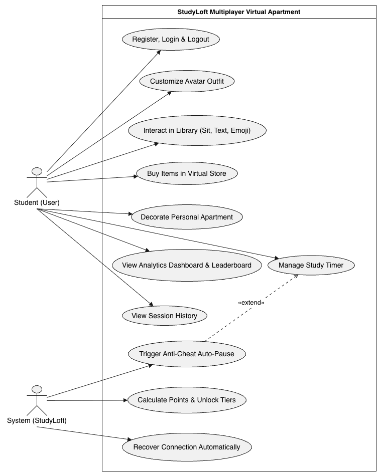

# Requirements Document

**BIL 481 Software Engineering - Project Assignment 1 (Fall 2026)**  
**Group:** DINC | **Finalization date:** 01-11-2026  
**Contributors to this document:** Delfin Kütükçü, Işıkalp Karakaş, Nildeniz Efe, Nadide Zeynep Dedeoğlu, Çınar Aktaş

## Table of Contents
1. [Introduction](#1-introduction)
2. [Use Case Diagram](#2-use-case-diagram)
3. [Functional Requirements](#3-functional-requirements)
4. [Non-Functional Requirements](#4-non-functional-requirements)
5. [Traceability to the Concept Notes](#5-traceability-to-the-concept-notes)
6. [Document-Specific Task Matrix](#6-document-specific-task-matrix)

---

## 1. Introduction
This document lists the requirements of StudyLoft, a multiplayer virtual apartment study platform. It refines the ten requirements from the group's Concept Notes (Assignment 0) into numbered, testable functional requirements (FR) and non-functional requirements (NFR). Each requirement has a verification statement describing how it will be checked.

**Terms:** a session is one study period measured by the timer; points are the spendable balance of a user; lifetime points are all points a user has ever earned and determine the unlocked furniture tier; the library is the shared ground-floor space; the apartment is a user's personal floor.

**Priorities:** M = must have, S = should have.

## 2. Use Case Diagram
The following diagram illustrates the main interactions between the users (students), the system, and the core functionalities of the StudyLoft platform.

## 3. Functional Requirements

| ID | Requirement | Priority | Verification |
| :--- | :--- | :--- | :--- |
| **FR-1** | The user must be able to register with a username, e-mail, and password, and to log in and log out. Usernames and e-mails must be unique. | M | Register two users; a duplicate username or e-mail is rejected; login with wrong password fails; logout ends the session. |
| **FR-2** | The user must be able to choose and change the avatar outfit from the clothing items the user owns. | S | Equip an owned item; it appears on the avatar in the library for other users; an unowned item cannot be equipped. |
| **FR-3** | The system must show the ground-floor library as a grid of tables and seats, marking each seat empty or occupied, and show online avatars with their current status (STUDYING, IDLE (PAUSED), or AVAILABLE). | M | With 3 test users online, all avatars and correct statuses are visible to each client. |
| **FR-4** | A logged-in user must be able to sit at an empty seat; a seat occupied by another user must not be selectable. Users must be able to sit at adjacent tables. | M | Take an empty seat (success); try an occupied seat (rejected); two users sit at adjacent tables and see each other. |
| **FR-5** | Users in the library must be able to send text messages (maximum 140 characters) and emoji reactions, shown as chat bubbles above the sender's avatar. The system must not provide voice or video chat. | M | Send a message and an emoji from user A; user B sees both within the latency limit; a 141-character message is rejected; no voice/video controls exist. |
| **FR-6** | The user must be able to start, pause, resume, and finish a study timer while seated; the system must compute the active study duration of the session. | M | Run a session with one manual pause; the stored duration equals elapsed time minus paused time (±2 s). |
| **FR-7** | The timer must pause automatically when the browser tab is hidden or minimized (anti-cheat), the avatar status must change to IDLE (PAUSED), and the number of automatic pauses must be saved as paused_count. | M | Switch tabs during a running timer; the timer stops, status changes for other users, and paused_count increases by 1 in the saved session. |
| **FR-8** | When a session of at least 15 minutes is finished, the system must award 5 points per active minute and update the user's points and lifetime points. Sessions shorter than 15 minutes must award no points. | M | A 30-minute session gives 150 points; a 14-minute session gives 0 points; a session record is saved in both cases. |
| **FR-9** | The system must unlock furniture tiers according to the user's lifetime points (initial thresholds: Tier 1 = 0, Tier 2 = 200, Tier 3 = 1000, Tier 4 = 3000) and show the user's current tier. | M | A user with 150 lifetime points sees Tier 1; after crossing 200, Tier 2 items become purchasable. |
| **FR-10** | The user must be able to browse the store (furniture and clothing, with name, cost, and tier) and buy an item whose tier is unlocked and whose cost does not exceed the user's points. The cost must be deducted and the item added to the inventory; otherwise the purchase must be rejected with a message. | M | A user with 500 points buys a 300-point Tier-2 desk and has 200 points left; with 100 points the same purchase is rejected and nothing changes. |
| **FR-11** | The user must be able to place, move, and remove owned items on the personal apartment grid with drag and drop, and save the layout so that it is restored at the next login. | M | Place a desk, save, log out and in; the desk is at the same coordinates. Items not owned cannot be placed. |
| **FR-12** | The dashboard must show a chart of the user's daily study hours for the current week. | M | With seeded sessions, chart values equal the stored session totals per day. |
| **FR-13** | The system must provide a global leaderboard ranking users by total study time for the current week and highlight the current user's rank. | S | Seed 5 users with different totals; ranks match descending study time. |
| **FR-14** | The system must produce a weekly habit report (total hours, number of sessions, average session length, longest streak of study days) and a short text insight generated through the Gemini API; if the API is unavailable, the report must still be shown without the insight. | S | Report numbers match seeded data; with the API disabled, the page still renders and shows no insight. |
| **FR-15** | If a WebSocket connection drops, the client must reconnect automatically using exponential backoff and restore the user's seat, status, and timer state; the user must be shown a "reconnecting" indicator meanwhile. | M | Disconnect the network for 10 s during a session; after reconnect the same seat and elapsed time are restored without manual action. |
| **FR-16** | The system must store every finished session with sessionID, userID, duration, date, and paused_count and let the user view the session history. | M | After three sessions, the history lists three records with correct values. |

## 4. Non-Functional Requirements

| ID | Category | Requirement | Verification |
| :--- | :--- | :--- | :--- |
| **NFR-1** | Performance | Real-time updates (avatar state, chat, presence) must reach other connected clients within 200 ms for at least 95% of messages with up to 50 concurrent users. | Load test with 50 simulated clients; measure send-to-receive latency and report the 95th percentile. |
| **NFR-2** | Reliability | The server must keep the authoritative timer state so that no more than 5 seconds of study progress is lost after a client disconnect; reconnection must succeed within 30 seconds after the network returns. | Disconnect/reconnect tests; compare timer values before and after. |
| **NFR-3** | Security | Passwords must be stored only as salted hashes; all traffic must use HTTPS/WSS; every WebSocket connection must be authenticated; input must be validated to prevent SQL injection and cross-site scripting. | Code review, inspection of the database, and basic injection tests. |
| **NFR-4** | Privacy | The system must collect only username, e-mail, and study data, and must let users delete their account together with their data. | Delete an account in a test environment and confirm that no personal records remain. |
| **NFR-5** | Scalability | The architecture must support at least 100 concurrent connections, and the real-time server must be able to run as several instances behind a load balancer (no per-process state that cannot be shared). | Load test with 100 clients; design review of session/state handling. |
| **NFR-6** | Usability | A new user must be able to register and start a first study session within 3 minutes without help; the interface must use consistent labels and clear status indicators. | User test with at least 8 students; 80% succeed within 3 minutes. |
| **NFR-7** | Compatibility | The web application must work in the latest versions of Chrome, Firefox, Edge, and Safari on desktop screens of 1280 px width or more. | Manual test checklist run in all four browsers. |
| **NFR-8** | Maintainability | Code must be in the shared GitHub repository, changes merged through pull requests with at least one review, and automated unit tests must cover the business logic for points, tiers, and timer calculation. | Repository history review; test report showing the covered modules. |

## 5. Traceability to the Concept Notes

| Concept Notes requirement | Covered by |
| :--- | :--- |
| 1. Real-time multiplayer library with text/emoji only | FR-3, FR-4, FR-5 |
| 2. Study timer with anti-cheat auto-pause | FR-6, FR-7 |
| 3. Gamification engine with tiered rewards | FR-8, FR-9 |
| 4. Virtual store | FR-10 |
| 5. Personal apartment decorator | FR-11 |
| 6. Analytics dashboard (leaderboards, graphs, weekly reports) | FR-12, FR-13, FR-14 |
| 7. Real-time synchronization and connection recovery | FR-15, NFR-2 |
| 8. Response time under 200 ms | NFR-1 |
| 9. Secure authentication and privacy | FR-1, NFR-3, NFR-4 |
| 10. Scalability with modern tech stacks | NFR-5 |

*Requirements FR-2, FR-16, NFR-6, NFR-7, and NFR-8 were added while refining the concept notes to make the system complete and testable.*

## 6. Document-Specific Task Matrix

| Task | Responsible member |
| :--- | :--- |
| Functional requirements FR-1 to FR-8 (auth, avatar, library, chat, timer) | Işıkalp Karakaş |
| Functional requirements FR-9 to FR-16 (rewards, store, decorator, analytics, reconnect, history) | Nadide Zeynep Dedeoğlu |
| Non-functional requirements NFR-1 to NFR-8 | Çınar Aktaş |
| Wording of UI-related requirements and usability criteria | Nildeniz Efe |
| Traceability table, consistency review with Concept Notes, PDF export | Delfin Kütükçü |
